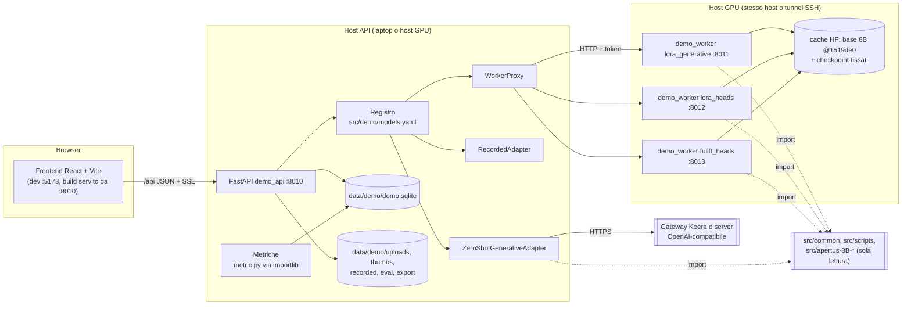
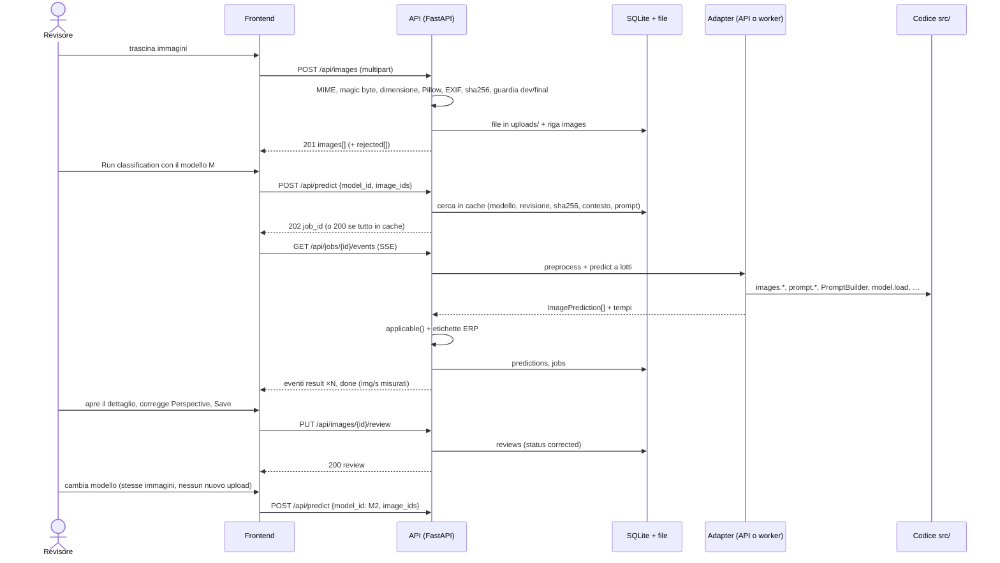

# Piano di implementazione — Demo "Image classification (AI)" per Galaxus

Team Bymo · Hack Apertus Zurich × Galaxus (`hackapertus-galaxus`). Piano scritto il **27/11/2026 (21:00–22:30
CET)**; verifiche su repository, branch e Hugging Face fatte nella stessa sessione (HF letto alle 20:08 UTC). In
questa sessione non è stato scritto codice: esistono solo questo file e gli allegati in `docs/demo/piano/`.

**Per chi implementa:** questo piano basta da solo. Leggi le sezioni 0–2, poi segui il
[piano di lavoro (allegato E)](piano/E_piano_lavoro.md) task per task. Le domande che solo il team può decidere sono
in [§16](#16-domande-aperte-per-il-team), ognuna con un default: se non c'è risposta, usa il default e annotalo in
`docs/demo/VERIFICA.md`.

| allegato | contenuto | sezioni |
|---|---|---|
| [A — Inventario verificato](piano/A_inventario.md) | albero del repo, 41 classi, regole `relevant`/`none`, schede modello, artefatti di valutazione, ambiente, gap | 3 |
| [B — Registro modelli e adapter](piano/B_registro_modelli.md) | interfaccia `ModelAdapter`, chiamate esatte al repo per ogni adapter, worker, `models.yaml` completo, memoria, hardware | 5 |
| [C — API](piano/C_api.md) | ogni endpoint con richiesta, risposta (valori segnaposto), errori | 7 |
| [D — Interfaccia](piano/D_interfaccia.md) | design token e procedura di misura, regole di stile, 6 schermate con wireframe, catalogo componenti | 10, 11, 12 |
| [E — Piano di lavoro](piano/E_piano_lavoro.md) | agenda, tagli di ambito, percorso critico, task M0–M7 con criteri di accettazione | 13 |

Legenda: **[VERIFICATO]** letto in un file o con un comando (fonte `percorso:riga` o `branch:percorso`) ·
**[STIMA]** nostro calcolo, non misurato · **[DA VERIFICARE]** non verificabile qui, elencato in §16 ·
**[DECISIONE PROPOSTA]** scelta del piano, modificabile dal team.

## 0. Cosa cambia rispetto al prompt di partenza

Le verifiche hanno corretto o completato alcuni dati del prompt del team:

1. **Gli screenshot non ci sono**: `docs/demo/reference/` non esiste. I token di design non sono misurati; c'è una
   procedura di misura e una palette di ripiego dichiarata ([allegato D, D.1](piano/D_interfaccia.md#d1-design-token)).
2. **Full fine-tune**: su HF esistono `phase2/model/epoch-1/` e, dalle 20:52 UTC, `epoch-2/` (non `phase2/epoch-1/`);
   `last/` e `dev_submission.csv` non esistono ancora, perché il job `6b09cdb46c5d61fff189842a` è **in corso** (`PHASE=2`,
   `EPOCHS=3`, a100-large). I layer 25–32 sono **eliminati**, non congelati. Il codice è solo sul branch
   `feat/apertus-8b-fullft-heads`, che **diverge** da main.
3. **LoRA P10**: l'adapter `final` (quello con 0.734 su coverage) **è perso**; restano gli snapshot
   `step-00123…step-00738`.
4. **C'è un modello in più, P11** (Apertus 8B + LoRA + 6 teste, 9.344 immagini): **0.781 su coverage**, il migliore
   misurato (src/RISULTATI.md:67). I pesi sono nel repo privato di un collega.
5. `CLAUDE.md` e `docs/context/*.md` esistono solo sul branch del full FT.
6. **Questa macchina non ha una GPU utilizzabile** (MX130 2 GB, driver non caricato, 7 GB di RAM) e non ha `.env`:
   oggi qui non gira nessun modello.
7. **[DECISIONE PROPOSTA]** Codice in `src/demo/` (non `demo/`): il template dice "`src/` = Your code"
   (README.md:52). Dati locali in `data/demo/` (non `demo_data/`): già esclusi da `.gitignore:30` e cancellati
   insieme ai dati della competizione dopo l'hackathon (src/RISULTATI.md:101).

---

## 1. Sintesi

**Obiettivo.** Un'applicazione dimostrativa (frontend + backend) che mostra come i modelli Apertus del team
entrerebbero nel flusso di Galaxus per i dati prodotto: nella pagina "Processed image" dell'ERP, il pannello
**"Image type"** (Subject, Background, Perspective, Individuals, Overlay, Language) arriva **pre-compilato da
Apertus v1.5**, una persona lo rivede, lo corregge e lo salva.

**Pubblico.** I rappresentanti di Galaxus (giuria del pitch, sabato 28/11 alle 15:00) e il video demo da massimo
2 minuti richiesto per la consegna delle 14:30 (README.md:82-84).

**Messaggi chiave.**
1. **Apertus pre-compila "Image type"** nel punto esatto del flusso ERP in cui oggi lavora il modello di Galaxus
   (challenge_description.md:5-8).
2. **Persona nel ciclo**: la revisione parte dalle immagini con la confidenza più bassa; ogni correzione è visibile
   (`AI suggested` → `Reviewed` / `Corrected`).
3. **Confronto tra modelli** sulle stesse immagini, senza ricaricarle: zero-shot 8B e 70B, LoRA, LoRA + teste, full
   fine-tune.
4. **Metriche oneste**: ogni numero dice set, fonte e dati di training; i numeri contaminati sono marcati in rosso;
   coverage è un set interno, non la classifica; per il modello di fase 2 l'unico numero valido è il punteggio
   Kaggle dev, inserito a mano.
5. **Velocità e costo** misurati, rispetto all'obiettivo di **≥ 2 immagini/s** (challenge_description.md:67) e al
   costo per 100.000 immagini, che vale il 20% della valutazione (challenge_description.md:220).

**Ambito.**

| dentro (MVP) | fuori | stretch |
|---|---|---|
| guscio in stile ERP con badge "Demo"; coda batch con upload validato; dettaglio con "Image type" pre-compilato, top-3, revisione e salvataggio; zero-shot 8B/70B live via gateway; modelli allenati live su GPU **o** registrati; confronto modelli; dashboard con metriche riportate e badge; velocità e costo misurati | collegamento all'ERP reale; uso di immagini dev/final; training o tuning con le correzioni; modifiche a `src/` fuori da `src/demo/`; quantizzazione; autenticazione multiutente | anteprima storefront con regola illustrativa; confidenza P10 completa (scoring vincolato); cache VQ condivisa; matrici di confusione ricalcolate con `evaluate.py` |

**Decisioni principali** (motivate nelle sezioni indicate).

| decisione | sezione |
|---|---|
| Tre modi di esecuzione: tutto su host GPU / laptop + worker remoto / laptop senza GPU con zero-shot live e modelli allenati **registrati** | 4, 5 |
| Un **processo worker per famiglia** di modelli (collisione dei moduli `data`, `encoders`, `model`) | 5 |
| Gli adapter chiamano le funzioni del repo; dove la logica è inline la ricompongono con un test di parità | 5, 14 |
| Metriche dal `metric.py` ufficiale caricato da `data/`, mai copiato | 9 |
| Badge su due assi: validità del set e provenienza del numero | 9 |
| Codice in `src/demo/`, dati in `data/demo/`, full FT letto da un `git worktree` | 0, 4 |
| Interfaccia **in inglese** (come l'ERP e per il pubblico Galaxus); piano e documenti in italiano | 10 ([D.2.1](piano/D_interfaccia.md#d21-lingua-dellinterfaccia-inglese-decisione-proposta)) |

---

## 2. Vincoli e regole

| vincolo | regola concreta per l'implementazione | fonte |
|---|---|---|
| Apertus classifica | a runtime solo Apertus v1.5 (8B o 70B, anche adattato); nessun modello chiuso né API proprietaria a runtime; altri modelli solo open-weights e di supporto | challenge_description.md:48-53 |
| Niente etichette a mano su dev/final, niente ricerche nello shop | nessuna funzione della demo apre o mostra immagini dev/final; guardia sugli hash in upload; nessuna ricerca web delle immagini | challenge_description.md:56-57 |
| Final solo per inferenza | la demo non tocca `final_encrypted.bin` né `final_images/` | challenge_description.md:86-87; CLAUDE.md:29 (branch) |
| Dati mai in git né nei pesi | niente immagini, CSV, ID, label, predizioni, database o screenshot nel repo; controllo `check_no_data.py` prima di ogni commit | challenge_description.md:232-236; .gitignore:29-41 |
| Stesso prompt e formato di training | preprocessing e prompt solo dalle funzioni del repo; test di parità | src/AGENTS.md:28 |
| Nessuna azione esterna senza richiesta | niente job a pagamento, submission Kaggle, push, download di pesi o installazioni senza ok esplicito | src/AGENTS.md:85; CLAUDE.md:34, 73 (branch) |
| Pipeline del sabato intoccabile | branch `feat/demo-app`; nessun file di `src/` modificato; nessun uso della GPU/HF del team tra 13:00 e 14:30; freeze della demo alle 11:30; video registrato prima delle 13:00 | challenge_description.md:67-69 |
| Lingua | documenti e commit in italiano, `feat:` / `docs:` / `chore:` | CLAUDE.md:67-68 (branch) |
| Segreti | `LLM_API_KEY` e token HF solo da ambiente o `.env` ignorato; mai stampati | src/AGENTS.md:67; .gitignore:1-4 |
| Immagini mostrabili | nel pitch, nel video e nel report si possono mostrare **poche** immagini della competizione | challenge_description.md:235-236; FAQ.md:114-116 |

### 2.1 Definition of Done

- [ ] Tutto il codice nuovo è in `src/demo/`; `git diff --stat main...feat/demo-app` non tocca altri file di `src/`.
- [ ] `.gitignore` contiene le regole di [§18](#18-gitignore-e-igiene-dei-dati); `check_no_data.py` passa; nessun
      file sotto `data/`, `docs/demo/reference/` o con estensione immagine/CSV/JSONL/SQLite è tracciato.
- [ ] `make -C src/demo demo` avvia la demo su `http://127.0.0.1:8010` con il badge "Demo — Team Bymo · Hack Apertus".
- [ ] Upload → classificazione → cambio modello senza ricaricare → confronto → revisione e salvataggio → dashboard,
      tutto funzionante con almeno **un modello vero** (live o registrato) e verificato da Playwright.
- [ ] Ogni metrica mostrata ha set, fonte `file:riga`, dati di training e badge; nessun numero inventato; il full FT
      non mostra metriche locali valide.
- [ ] Ogni modello eseguito ha superato il test di parità (§14.2) o è etichettato "parity not verified".
- [ ] Velocità mostrate solo se misurate, con GPU e batch.
- [ ] `src/demo/README.md`, `docs/demo/VERIFICA.md`, `docs/demo/SCRIPT_PRESENTAZIONE.md` scritti.
- [ ] Piano B pronto: sessione di presentazione con predizioni registrate, avviabile senza rete.
- [ ] Commit in italiano; nessun push, job o submission senza richiesta.

---

## 3. Inventario verificato del repository

Dettagli completi, con fonti riga per riga, in [allegato A](piano/A_inventario.md). Sintesi:

**Tassonomia:** 41 classi in `src/common/prompt.py:26-42`, uguali a `metric.VALID_CLASSES` [VERIFICATO]; l'ordine
fissa l'indice delle teste e la lettera del prompt v2. Tabella completa con indice, lettera ed etichetta ERP in
[A.2](piano/A_inventario.md#a2-tassonomia-41-classi); regole `relevant`/`none`/`-` in
[A.2.1](piano/A_inventario.md#a21-none-relevant-e--).

**Modelli:**

| ID | cosa | training | metrica principale (set, fonte) | pesi | eseguibile qui | stato |
|---|---|---|---|---|---|---|
| `apertus-8b-zeroshot-v2` | 8B, prompt v2 `describe:codes:512`, gateway | nessuno | 0.528 coverage, 0.502 prompt-test (prompt_eval_coverage.md:45, 69) | remoti (Keera) | sì, con `LLM_API_KEY` | `unavailable` (manca `.env`) |
| `apertus-70b-zeroshot-v2` | 70B, stesso prompt | nessuno | 0.583 coverage, 0.590 prompt-test (:47, 71) | remoti | sì, con chiave | `unavailable` (manca `.env`) |
| `apertus-8b-lora-p10` | 8B + LoRA, JSON generato, 256² | 1.500 immagini | 0.734 coverage **dell'adapter `final` perso** (eval_coverage.json) | `StoryofLegend/apertus-8b-galaxus-lora` @be79276, `prototype-256/adapters/step-00738` | no (GPU) | `needs GPU` |
| `apertus-8b-lora-heads-p11` | 8B + LoRA + 6 teste, 256² | 9.344 (fase 1) | 0.781 coverage, 0.791 prompt-test (results_full_h200.md:23-25) | repo privato di un collega [DA VERIFICARE] | no (GPU) | `weights missing` |
| `apertus-8b-fullft-heads` | 8B troncato a 24 layer, tutti allenati, 6 teste | 11.876 (fase 2) | **nessuna valida in locale**; Kaggle dev non ancora disponibile | `StoryofLegend/apertus-8b-galaxus-fullft` @711018b, `phase2/model/epoch-1` (10,49 GB; `epoch-2` presente dalle 20:52 UTC) | no (GPU) | `needs GPU`, checkpoint finale in arrivo |
| `apertus-8b-frozen-heads-p8` / `-p9` | 8B congelato + teste, 512² | 1.500 | 0.542 / 0.557 su validation_450 (confronto_lora.md:35-36) | non su questa macchina | no | `unavailable` (solo metriche) |

**Artefatti di valutazione** ([A.5](piano/A_inventario.md#a5-artefatti-di-valutazione)): nessuna predizione per
immagine su questa macchina; metriche complete leggibili da macchina solo per P10 (JSON); il resto è markdown;
unica matrice di confusione: perspective di P11 su coverage (results_full_h200.md:122-136); nessun punteggio Kaggle
dev registrato (src/RISULTATI.md:90).

**Funzione di punteggio:** il repo usa sempre `metric.py` dei dati Kaggle, caricato con `importlib`
(src/scripts/eval_prompt.py:59-63; src/apertus-8B-lora-heads/data.py:166-172). Nessuna reimplementazione.

**Gap:** 18 punti in [A.7](piano/A_inventario.md#a7-gap-trovati-e-gestione-proposta); i più importanti: screenshot
assenti (G1), codice del full FT solo su branch (G3), adapter P10 perso (G5), pesi P11 non accessibili (G6), nessuna
GPU (G11), moduli con lo stesso nome tra cartelle (G15).

---

## 4. Architettura

### 4.1 Componenti



Versione testuale: `Browser → FastAPI (:8010) → {ZeroShot → Keera | Recorded → data/demo/recorded | WorkerProxy →
worker per famiglia (:8011–8013) → codice src/ + cache HF}`; l'API scrive tutto in `data/demo/`.

### 4.2 Stack

| parte | scelta | perché |
|---|---|---|
| backend | Python del `.venv` del repo (3.12.15; il codice del repo chiede ≥ 3.11), FastAPI + Uvicorn, Pydantic 2.14.4 (già installato), `sqlite3` della libreria standard (niente ORM), PyYAML, httpx | il `.venv` ha già il fork di transformers, pandas 3.1.1 e pillow 13.0.0 alle versioni del repo [VERIFICATO A.6]; meno dipendenze nuove |
| worker GPU | stesse versioni dei job: torch 2.8.0, torchvision 0.23.0, fork transformers @3797303, peft 0.22.0, accelerate 1.16.0 | identiche a quelle che hanno prodotto i pesi (src/apertus-8B-lora-heads/build_hf_job.py:40-55) |
| frontend | React + TypeScript + Vite, Tailwind CSS, TanStack Query, React Router, Recharts (+ visx per la heatmap), react-dropzone; Playwright per gli E2E | nessun frontend esistente nel repo; Node 22.22.2 e npm 10.9.7 presenti [VERIFICATO]; versioni fissate dal lockfile in M0.4 |
| tempo reale | Server-Sent Events (`StreamingResponse`), con ripiego a polling | un solo verso (server → client) basta; nessuna libreria in più |

### 4.3 Struttura delle cartelle nuove

```
src/demo/
├── README.md                    avvio, requisiti, modi di esecuzione (§17)
├── Makefile                     dev, demo, test, e2e, check, clean-data
├── models.yaml                  registro (allegato B, B.7)
├── config/
│   ├── erp_labels.yaml          etichette ERP (4 note + regola auto)
│   └── storefront_rule.yaml     regola illustrativa (stretch)
├── backend/
│   ├── requirements.txt         API (CPU)
│   ├── requirements-gpu.txt     worker (versioni dei job)
│   ├── demo_api/                main.py, settings.py, errors.py, db.py, storage.py, images_io.py, guard.py,
│   │   │                        taxonomy.py, relevance.py, registry.py, jobs.py
│   │   ├── adapters/            base.py, zeroshot.py, recorded.py, worker_proxy.py
│   │   ├── metrics/             compute.py, badges.py, reported.py
│   │   └── routers/             health, taxonomy, models, sessions, images, predict, reviews, metrics, export, recorded
│   ├── demo_worker/             server.py, families/{lora_generative,lora_heads,fullft_heads}.py
│   └── tests/                   pytest (§14.1)
├── frontend/                    Vite: src/{api,components,pages,styles}, e2e/
└── scripts/                     check_no_data.py, build_guard_index.py, import_reported.py, evaluate.py,
                                 export_session.py, record.py, fetch_weights.py, parity.py
docs/demo/
├── PIANO_DEMO.md, piano/*.md    questo piano
├── VERIFICA.md                  registro delle verifiche (da scrivere)
├── SCRIPT_PRESENTAZIONE.md      copione (da scrivere)
└── reference/                   screenshot, IGNORATI da git
data/demo/                       IGNORATO (.gitignore:30): database, upload, registrazioni, valutazioni
```

Comando unico: `make -C src/demo demo` (build del frontend e API su :8010 in modalità presentazione). Nessun
`Makefile` nella radice, per non cambiare il layout del template (README.md:40-52).

### 4.4 Import del codice esistente senza modificarlo

- L'API aggiunge `<repo>/src` a `sys.path` e importa `common.prompt`, `common.images`, `common.splits`;
  `src/scripts/eval_prompt.py` è caricato da file con `importlib` come modulo `bymo_eval_prompt`.
- Ogni worker aggiunge **solo** la cartella della propria famiglia (tabella in
  [B.6](piano/B_registro_modelli.md#b6-come-il-worker-importa-il-codice-del-repo-senza-modificarlo)) e verifica da
  quale file arriva ogni modulo.
- Il full FT si legge da `git worktree add ../hack-apertus-fullft feat/apertus-8b-fullft-heads` con
  `DEMO_FULLFT_SRC`, finché il team non lo unisce in main.
- Mai copiare funzioni del repo; mai creare una cartella chiamata `data` (ignorata da `.gitignore:30`).

### 4.5 Ciclo di vita: upload → predizione → revisione → salvataggio



---

## 5. Registro modelli e adapter

Dettagli, chiamate esatte e `models.yaml` completo in [allegato B](piano/B_registro_modelli.md).

| adapter | modelli | dove gira | funzioni del repo chiamate (sintesi) |
|---|---|---|---|
| `ZeroShotGenerativeAdapter` | 8B, 70B zero-shot v2 | processo API | `images.data_url`, `prompt.describe_messages`, `prompt.question_messages`, `prompt.question_constraint`, `prompt.parse_question`, `eval_prompt.complete` |
| `LoraGenerativeAdapter` | P10 | worker `lora_generative` | `apertus_lora.load_vision_tokenizer`, `images.prepared_image`, `encode_image`, `Sequences.prompt_ids`, `collate`, `parse_answer` + caricamento e `generate` come `evaluate.py:136-159` |
| `HeadsAdapter` (`lora_heads`) | P11 | worker `lora_heads` | `model.load`, `encoders.ImageEncoder.encode`, `encoders.PromptBuilder.ids`, `encoders.collate`, `predict.fingerprint` |
| `HeadsAdapter` (`fullft_heads`) | full FT | worker `fullft_heads` | `ft_model.load`, `ft_encode.VQEncoder.encode`, `encoders.PromptBuilder(prefix_tokens=0).ids`, `encoders.collate`, `ft_train.autocast`, `data.prediction_frame` |
| `RecordedAdapter` | qualsiasi modello registrato | processo API | nessuna: legge `data/demo/recorded/` prodotto da `record.py` con gli adapter qui sopra |
| `WorkerProxy` | P10, P11, full FT | processo API | inoltra al worker via HTTP |

**Memoria** (B.8): caricamento pigro; un modello residente di default; budget VRAM = memoria del worker − 2 GB; LRU
che non scarica modelli con job attivi; nessuna condivisione della base tra modelli (LoRA fusi, layer sostituiti);
OOM in caricamento → errore e uscita del worker; OOM in predizione → un tentativo a batch dimezzato.

**Hardware** (B.9): GPU ≥ 24 GB per i modelli locali [STIMA dal picco misurato di P11, 22,0 GB:
results_full_h200.md:156]; 70B solo remoto; nessuna quantizzazione nell'MVP; pesi privati con il token HF
dell'utente; download solo su richiesta esplicita e con conferma della dimensione (base 18,4 GB, full FT 10,49 GB,
P10 0,319 GB).

---

## 6. Confidenza

| famiglia | metodo | distribuzione | top-k | note |
|---|---|---|---|---|
| teste (P11, full FT) | softmax dei logit di ogni testa, come predict.py:142 e ft_predict.py:87 | completa sulle classi della dimensione | le 3 probabilità più alte | P11 allenato con cross-entropy, full FT con focal γ=2 + alpha per classe: la focal e i pesi spostano le probabilità, quindi **le due confidenze non sono confrontabili**. Nessuna calibrazione: calibrare su coverage è vietato in fase 1 (src/AGENTS.md:47) |
| zero-shot v2 (8B, 70B) | probabilità della lettera dalle top-20 logprob, rinormalizzate sulle lettere valide (`prompt._distribution`, prompt.py:378-386) | completa | le 3 più alte | condizionata alla descrizione generata dallo stesso modello; se le logprob mancano → `null` |
| LoRA generativo (P10) — **metodo A (default)** | `generate(..., output_scores=True, return_dict_in_generate=True)`; confidenza = prodotto delle probabilità dei token del valore scelto, individuati con gli offset del testo generato | solo la classe scelta | `null` | `confidence_method = "sequence_prob"`; il test di parità verifica che le sequenze siano identiche con e senza `output_scores` |
| LoRA generativo (P10) — metodo B (stretch) | scoring vincolato: per ogni dimensione, nell'ordine di `DIMENSIONS`, con il prefisso JSON costruito dai valori greedy precedenti (formato di `serialize_answer`, apertus_lora.py:272-280), log-verosimiglianza di ogni classe + virgolette di chiusura; softmax sulle classi | completa | le 3 più alte | 41 continuazioni per immagine (6 forward con prefisso condiviso); **la label resta quella greedy** (parità); se l'argmax del metodo B è diverso, icona di avviso |

Regole:

- **Output non valido**: per P10 `parse_answer` restituisce `None` → tutte le 6 dimensioni "Output non valido",
  testo grezzo visibile, nessuna riparazione né mappatura inventata; per lo zero-shot vale per dimensione. Nelle
  statistiche del batch conta come errore.
- **Fasce di colore** del chip: < 0,60 bassa, 0,60–0,90 media, ≥ 0,90 alta, le stesse fasce usate nell'analisi
  della confidenza del 70B (src/apertus-8B-benchmark/teacher_student_zeroshot.md:57). Configurabili. Sono solo un
  aiuto visivo, non soglie validate.
- **Spiegazione in UI**: tooltip del chip e `ConfidenceMethodNote` con il metodo ("Head softmax probability",
  "Answer-letter probability", "Probability of the generated value") e la frase "Confidence values from different
  methods are not comparable." (testi esatti in [D.2.1](piano/D_interfaccia.md#d21-lingua-dellinterfaccia-inglese-decisione-proposta)).
  Nel confronto modelli la confidenza resta per cella, mai aggregata tra modelli.
- **Assente** → `null` → "n/a".
- Dato verificato utile per il racconto: nel 70B zero-shot su coverage l'accuratezza di subject è 76,6% con
  confidenza ≥ 0,90 e 32,9% sotto 0,60 (teacher_student_zeroshot.md:57-59): la confidenza aiuta il triage. Per i
  modelli allenati la stessa analisi **non esiste** finché non ci sono predizioni per immagine (§9).

---

## 7. API del backend

Schemi completi in [allegato C](piano/C_api.md); tutti gli esempi lì usano valori segnaposto.

| metodo | percorso | scopo |
|---|---|---|
| GET | `/api/health` | stato, commit, worker raggiungibili |
| GET | `/api/taxonomy` | 41 classi, etichette ERP, regole di applicabilità, fasce di confidenza |
| GET / PUT | `/api/settings` | GPU e $/h, modalità presentazione, contesto di default |
| GET | `/api/models`, `/api/models/{model_id}` | registro con stato e motivo |
| POST | `/api/models/{model_id}/load`, `/unload`, `/download` | gestione dei modelli (download solo con `confirm: true`) |
| POST / GET | `/api/sessions`, `/api/sessions/{session_id}` | sessioni |
| POST | `/api/images` | upload multipart validato (MIME + magic byte + dimensione + decodifica Pillow + EXIF + guardia) |
| GET | `/api/images`, `/api/images/{image_id}`, `…/file`, `…/thumbnail` | immagini e metadati |
| PUT | `/api/images/{image_id}/context` | contesto prodotto facoltativo |
| POST | `/api/predict` | `{model_id, image_ids, use_context, mode}` → job; cache per `(modello, revisione, sha256, contesto, prompt, modo)` |
| GET | `/api/jobs/{job_id}`, `/api/jobs/{job_id}/events` (SSE), `POST …/cancel` | avanzamento e risultati |
| GET | `/api/events` (SSE) | stati dei modelli |
| GET | `/api/predictions` | predizioni per sessione, modello, immagine |
| PUT / GET | `/api/images/{image_id}/review`, `…/reviews` | revisione umana |
| GET | `/api/metrics/{model_id}`, `/api/metrics/compare` | metriche con badge; `dev`/`final` rifiutati |
| GET | `/api/throughput` | img/s misurati e riportati, costo per 1.000 immagini |
| GET | `/api/export.csv` | export della sessione |
| POST | `/api/recorded/rescan` | rilegge le registrazioni |

Errori: schema unico `{"error": {code, message, details, request_id}}` con i codici `VALIDATION_ERROR`,
`NOT_FOUND`, `MODEL_NOT_FOUND`, `UNSUPPORTED_MEDIA_TYPE`, `FILE_TOO_LARGE`, `IMAGE_TOO_LARGE`, `CORRUPT_IMAGE`,
`FORBIDDEN_IMAGE`, `MODEL_UNAVAILABLE`, `MODEL_LOADING`, `MODEL_BUSY`, `CONFIRMATION_REQUIRED`, `GPU_OOM`,
`UPSTREAM_ERROR`, `TIMEOUT`, `RECORDED_MISSING`, `INTERNAL_ERROR` ([C.1](piano/C_api.md#c1-schema-di-errore-unificato)).

---

## 8. Modello dati

SQLite in `data/demo/demo.sqlite` (WAL), creato con `CREATE TABLE IF NOT EXISTS` all'avvio. Tipi SQLite; JSON come
`TEXT`; date ISO 8601 UTC.

| tabella | colonne |
|---|---|
| `sessions` | `session_id TEXT PK`, `name TEXT NOT NULL`, `created_at TEXT NOT NULL`, `notes TEXT` |
| `images` | `image_id TEXT PK`, `session_id TEXT NOT NULL → sessions`, `original_filename TEXT`, `sha256 TEXT NOT NULL`, `mime TEXT`, `format TEXT`, `width INTEGER`, `height INTEGER`, `bytes INTEGER`, `has_alpha INTEGER`, `exif_transposed INTEGER`, `stored_path TEXT`, `thumb_path TEXT`, `source_kind TEXT CHECK (source_kind IN ('own_photo','train_coverage','other'))`, `context_json TEXT NOT NULL DEFAULT '{}'`, `context_hash TEXT NOT NULL`, `created_at TEXT`; `UNIQUE (session_id, sha256)` |
| `predictions` | `prediction_id TEXT PK`, `image_id TEXT → images`, `image_sha256 TEXT`, `model_id TEXT`, `model_revision TEXT` (sha HF + sottocartella, o `predict.fingerprint`), `prompt_version TEXT`, `use_context INTEGER`, `context_hash TEXT`, `mode TEXT CHECK (mode IN ('live','recorded'))`, `recorded_run_id TEXT`, `valid INTEGER`, `dimensions_json TEXT` (6 × `{label, confidence, top_k, confidence_method}`), `raw_output TEXT`, `timing_json TEXT`, `job_id TEXT`, `created_at TEXT`; `UNIQUE (model_id, model_revision, image_sha256, context_hash, use_context, prompt_version, mode)` |
| `reviews` | `review_id TEXT PK`, `image_id TEXT → images`, `prediction_id TEXT → predictions`, `model_id TEXT`, `values_json TEXT`, `changed_json TEXT`, `status TEXT CHECK (status IN ('reviewed','corrected'))`, `note TEXT`, `created_at TEXT` |
| `jobs` | `job_id TEXT PK`, `kind TEXT CHECK (kind IN ('predict','load','download','evaluate'))`, `model_id TEXT`, `status TEXT`, `total INTEGER`, `done INTEGER`, `started_at TEXT`, `finished_at TEXT`, `seconds REAL`, `images_per_second REAL`, `gpu_name TEXT`, `batch_size INTEGER`, `peak_memory_gb REAL`, `error_json TEXT` |
| `eval_results` | `eval_id TEXT PK`, `model_id TEXT`, `set_name TEXT`, `checkpoint TEXT`, `validity TEXT CHECK (validity IN ('held_out','phase1_internal','seen_in_training','na'))`, `provenance TEXT CHECK (provenance IN ('recomputed','offline_script','reported_only','kaggle_user'))`, `source TEXT` (`file:riga`), `trained_on TEXT`, `macro_f1 REAL`, `weighted_f1 REAL`, `accuracy_json TEXT`, `per_dimension_json TEXT`, `per_class_json TEXT`, `confusion_json TEXT`, `calibration_json TEXT`, `computed_at TEXT`, `notes_json TEXT` |
| `recorded_runs` | `run_id TEXT PK`, `model_id TEXT`, `path TEXT`, `recorded_at TEXT`, `gpu_name TEXT`, `images INTEGER`, `meta_json TEXT` |
| `settings` | `key TEXT PK`, `value_json TEXT` |

File in `data/demo/` (tutto ignorato da git):

```
data/demo/
├── demo.sqlite (+ -wal, -shm)
├── uploads/<sha256[:2]>/<sha256>.<jpg|png|webp>   byte originali (o PNG raddrizzato se c'era EXIF)
├── thumbs/<sha256>.jpg                            miniature 256 px
├── recorded/<model_id>/<run_id>/{run.json, predictions.jsonl}
├── export/<session_id>/{images/, manifest.json}   per record.py su host GPU
├── eval/<model_id>/<set>/{predictions.csv, probs.json, metrics.json, run.json}
├── cache/vq/256/<sha256>.pt                       facoltativa, solo dopo la parità dei codici
├── guard/sha256.txt                               hash di dev_images (e final_images)
└── logs/api.log
```

**Ciclo di vita della sessione:** creazione → upload (una volta) → predizioni con il modello A → cambio a B sulle
stesse righe di `images` (nessun nuovo upload; cache per modello) → revisioni → export → la sessione resta finché
`make -C src/demo clean-data` non cancella `data/demo/` (da fare dopo l'hackathon con gli altri dati della
competizione, src/RISULTATI.md:101).

**Le correzioni umane sono solo dati della demo**: nessun endpoint, script o formato le trasforma in dati di
training; `src/demo/README.md` lo scrive in chiaro.

---

## 9. Metriche e dashboard

### 9.1 Fonti di verità in ordine di priorità

| priorità | fonte | `provenance` | disponibilità oggi |
|---|---|---|---|
| 1 | predizioni per immagine su un set etichettato, ricalcolate con `metric.py` | `recomputed` | **nessuna** su questa macchina |
| 2 | output di `src/demo/scripts/evaluate.py` (sotto) | `offline_script` | non ancora eseguito (serve GPU o chiave Keera, e un ok) |
| 3 | punteggi riportati nei file del repo (JSON di P10, markdown di P4, P8/P9, P11) | `reported_only` | sì: importati da `import_reported.py` con `file:riga` |
| 4 | punteggio Kaggle dev scritto a mano dall'utente in `models.yaml` (`kaggle_dev.score`) | `kaggle_user` | nessuno ancora |

**`evaluate.py` (spec).**
`python src/demo/scripts/evaluate.py --model <model_id> --set {coverage|base|prompt-test|validation_450}
[--limit N] [--batch-size 32] [--allow-contaminated]`

- Input: righe da `common.splits.split_rows(rows, set)` (o `data/prototype_splits/validation_450.csv`) su
  `data/hackapertus-galaxus/train.csv`; immagini da `train_images/`; stessi adapter della demo in modalità batch.
- Rifiuta `dev`, `final` e qualsiasi CSV non derivato dal train. Rifiuta i set elencati in `training.seen_sets` del
  modello, salvo `--allow-contaminated`, che marca il risultato `seen_in_training`.
- Output in `data/demo/eval/<model_id>/<set>/`: `predictions.csv`, `probs.json`, `metrics.json` (`metric.evaluate`
  + accuratezza + confusioni + dati di calibrazione), `run.json` (GPU, img/s, commit, revisione dei pesi, data).
- Tempi attesi da misure del repo: P11 su coverage 191,5 s + caricamento (results_full_h200.md:156); zero-shot 8B
  su coverage ≈ 2.532 / 3,8 img/s ≈ 11 min e 70B ≈ 2.532 / 2,8 ≈ 15 min sul gateway condiviso [STIMA da
  prompt_eval_coverage.md:97, 99]; P10 non misurato end-to-end.
- Si lancia **solo con l'ok dell'utente** e mai tra le 13:00 e le 14:30 di sabato.

### 9.2 Calcolo esatto

- **Celle valutate**: label umana in una dimensione rilevante, `common.splits.scored_cells` (splits.py:33-37);
  soluzione con le celle non valutate vuote, come `data.solution_frame` (src/apertus-8B-lora-heads/data.py:157-163).
- **Macro F1 per dimensione** e **media delle 6**, **weighted F1**, P/R/F1/supporto per classe: `metric.evaluate`
  (data/hackapertus-galaxus/metric.py:73-94), mai reimplementati. Classi = label ∪ classi valide predette; una
  cella predetta vuota è sbagliata ma non crea una classe (metric.py:141-169).
- **Accuratezza per dimensione** (non nella metrica ufficiale, mostrata come informazione): risposte esatte / celle
  valutate.
- **Matrice di confusione**: sulle stesse celle; righe = label, colonne = predizioni nell'ordine della tassonomia +
  colonna "vuota/non valida"; normalizzazione per riga attivabile.

**Esempio calcolato a mano** (5 immagini finte; verificato con `metric.evaluate` il 27/11, stesso risultato):

| immagine | background: label | background: predetto | individuals: label | individuals: predetto |
|---|---|---|---|---|
| e1 | white | white | none | none |
| e2 | white | white | none | individual_present |
| e3 | white | color | none | *(vuota)* |
| e4 | color | color | *(non valutata)* | none |
| e5 | scene_lifestyle | white | *(non valutata)* | none |

- background (5 celle; classi white, color, scene_lifestyle): white P = 2/3, R = 2/3, F1 = 0,6667; color P = 1/2,
  R = 1, F1 = 0,6667; scene_lifestyle P = 0, R = 0, F1 = 0 → **macro 0,4444**, weighted (0,6667·3 + 0,6667·1 +
  0·1)/5 = **0,5333**, accuratezza 3/5 = 0,6.
- individuals (3 celle valutate; classi none ∪ individual_present predetta): none P = 1/1, R = 1/3, F1 = 0,5;
  individual_present P = 0, R = 0, F1 = 0, supporto 0 → **macro 0,25**, weighted (0,5·3 + 0·0)/3 = **0,5**.
- Complessivo (solo dimensioni con celle valutate): macro (0,4444 + 0,25)/2 = **0,3472**; weighted
  (0,5333·5 + 0,5·3)/8 = **0,5208**.

Questo esempio diventa `tests/test_metrics.py` (M4.1).

### 9.3 Badge

Due assi, entrambi sempre visibili accanto a ogni numero.

| asse | valore | testo del badge | colore |
|---|---|---|---|
| validità | `held_out` | "held-out" | neutro |
| | `phase1_internal` | "phase-1 internal set (coverage)" | ambra |
| | `seen_in_training` | "seen during training — invalid" | rosso, barre tratteggiate, escluso di default dai confronti |
| | `na` | "n/a" | grigio |
| provenienza | `recomputed` / `offline_script` | "recomputed" | — |
| | `reported_only` | "reported only" | grigio |
| | `kaggle_user` | "Kaggle dev (public)" | blu |

Assegnazione oggi:

| modello | coverage / base | prompt-test | validation_450 | Kaggle dev |
|---|---|---|---|---|
| 8B / 70B zero-shot v2 | phase-1 internal · reported only (nota: prompt scelto su prompt-dev ⊂ coverage) | held-out · reported only | — | n/a |
| P10 | phase-1 internal · reported only (adapter `final`, non quello caricato) | phase-1 internal · reported only | held-out · reported only | n/a |
| P11 | phase-1 internal · reported only | phase-1 internal · reported only | — (validation_450 è dentro training_rows: non valido) | n/a |
| full FT fase 2 | **seen during training — invalid** | **seen during training — invalid** | **seen during training — invalid** | n/a finché l'utente non lo inserisce |
| P8 / P9 | — | — | held-out · reported only (set bilanciato) | n/a |

Banner fisso nella dashboard (testo `banner.coverage` di D.2.1): coverage è un set interno di fase 1, arricchito con
classi rare; serve a confrontare metodi, non stima la classifica Kaggle (src/common/splits.py:12-13). Il badge rosso
ha il tooltip "This model was trained on these images: not a valid evaluation."

### 9.4 Grafici

1. **Card per modello**: macro F1 sul set scelto con badge, weighted F1, dati di training, revisione dei pesi,
   img/s misurati con GPU, costo per 1.000 immagini, punteggio Kaggle dev se inserito.
2. **Macro F1 per dimensione per modello** (barre raggruppate) con linea a **0,917** etichettata
   **"Organisers' reference (Qwen 3.5 9B FT, dev)"** (challenge_description.md:143) e la nota "Different set (Kaggle
   dev): not directly comparable with coverage".
3. **Tabella per classe**: P/R/F1/supporto; classi con supporto < 30 evidenziate (30 è l'obiettivo per classe di
   coverage, src/common/splits.py:21-22).
4. **Matrice di confusione** per dimensione con normalizzazione per riga: oggi solo P11 / perspective / coverage;
   le altre dopo `evaluate.py`.
5. **Confidenza corrette vs sbagliate** e **curva di calibrazione** (10 fasce): solo con predizioni per immagine
   (priorità 1–2); altrimenti "n/a" con il motivo.
6. **Velocità e costo**: img/s misurati nella demo e riportati, sempre con GPU, batch e cosa include il tempo; linea
   dell'obiettivo 2 img/s; costo per 1.000 immagini = `usd_per_hour / (img_s × 3600) × 1000` con il prezzo **della
   GPU su cui è stata misurata la velocità** (se si sceglie un'altra GPU, avviso "stima non valida"). Controllo con
   i numeri del repo: P11, 13,2 img/s su H200 a 5 $/h → 0,105 $ per 1.000 immagini, cioè 10,5 $ per 100.000, come
   riporta results_full_h200.md:159-160. Default del pannello: A100 80 GB a 2,50 $/h (README del full FT, riga 71).
   Per il gateway Keera il costo è "n/a".

### 9.5 Metriche di set e confidenza per immagine restano separate

- La dashboard non mostra mai la confidenza di un'immagine caricata; coda, dettaglio e confronto non mostrano mai
  metriche di set, solo il link "Come va questo modello sui set di prova →".
- Le etichette sono diverse: "Macro F1 su <set>" contro "Confidenza del modello su questa immagine".
- Sulle immagini nostre non c'è una label vera: nessuna "accuratezza" viene calcolata sulle immagini caricate.
  Mostrare la label umana per immagini `train_coverage` è possibile solo con `show_ground_truth` attivo
  (default spento, domanda Q9) e, per il full FT, con il badge "visto in training".

---

## 10. Design system

In [allegato D, D.1–D.3](piano/D_interfaccia.md#d1-design-token). In sintesi: i token sono variabili CSS in
`tokens.css` esposte a Tailwind; **nessun valore è misurato** perché gli screenshot mancano; procedura di misura con
un comando Pillow sul rettangolo di ogni token; palette di ripiego Tailwind dichiarata; nessun logo o asset Galaxus;
"ERP" e "GALAXUS" come testo con icona SVG generica; badge permanente **"Demo — Team Bymo · Hack Apertus"**; due
densità (laptop e TV); contrasto AA; confidenza mai solo colore; scorciatoie da tastiera.

## 11. Specifica delle schermate

In [allegato D, D.4](piano/D_interfaccia.md#d4-schermate), con wireframe, componenti, dati, interazioni e stati:

| # | schermata | route | screenshot |
|---|---|---|---|
| 1 | Guscio ERP + pagina prodotto demo, voce `Product data → Image classification (AI)` | `/product/DEMO-0001` (layout su tutte) | A |
| 2 | Coda di classificazione | `/image-classification?session=…` | A, B |
| 3 | Dettaglio immagine con "Image type" | `/image-classification/:imageId?model=…` | C |
| 4 | Confronto modelli | `/image-classification/compare?session=…&models=…` | — |
| 5 | Dashboard delle prestazioni | `/image-classification/performance?set=…` | — |
| 6 | (stretch) Anteprima storefront con regola illustrativa | `/storefront-preview?session=…&model=…` | D |

## 12. Catalogo componenti frontend

In [allegato D, D.5](piano/D_interfaccia.md#d5-catalogo-dei-componenti): oltre 60 componenti con responsabilità, props,
stati e schermate (`ErpShell`, `Sidebar`, `TitleBar`, `ActionToolbar`, `CollapsibleSection`, `LabelValueGrid`,
`ImageTypePanel`, `ConfidenceChip`, `ModelSelect`, `UploadDropzone`, `ResultsTable`, `ComparisonGrid`,
`ConfusionMatrix`, `MetricBadge`, …).

## 13. Piano di lavoro

In [allegato E](piano/E_piano_lavoro.md): agenda (freeze sabato 11:30, video 12:00–12:45, nessun lavoro sulla demo
13:00–14:30), tagli di ambito (A minimo ~9 h con due flussi, B completo senza GPU, C con GPU), percorso critico e
task M0–M7 con file, dipendenze, passi, criteri di accettazione, stima e messaggio di commit.

Percorso critico: M0.1 → M0.3 → M1.1 → M1.3 → M1.4 → M1.5 → (M1.6 zero-shot | M1.7 registrato) → M2.1 → M2.2 →
M2.3 → M2.4 → M4.2 → M4.4 → M7.3.

---

## 14. Piano di test e verifica

### 14.1 Test unitari (pytest)

In `src/demo/backend/tests/`, eseguiti con `.venv/bin/python -m pytest -q`. Mock **solo nei test**; immagini di test
generate in memoria con Pillow (nessun file committato).

| file | cosa verifica |
|---|---|
| `test_taxonomy.py` | 41 stringhe esatte in 6 dimensioni, uguali a `prompt.TAXONOMY` e (se presente) a `metric.VALID_CLASSES`; ordine e lettere |
| `test_relevance.py` | un caso per ogni regola di challenge_description.md:102-107, più casi "tutto applicabile" |
| `test_upload.py` | i casi di M1.4: formati, magic byte, file troncato, GIF animata, dimensione, pixel, EXIF, duplicati, byte invariati |
| `test_guard.py` | un file con hash nell'indice è rifiutato |
| `test_metrics.py` | l'esempio di §9.2 (0,4444 / 0,25 / 0,3472 / 0,5208); confusione e accuratezza dello stesso esempio |
| `test_import_reported.py` | valori noti: P11 coverage 0.781, perspective 0.625, matrice 10×10 con riga `front_head_on` = 614; zero-shot 8B coverage 0.528; P10 dal JSON |
| `test_registry.py` | schema di `models.yaml`; stati e motivi senza chiave, senza pesi, con campi `[DA VERIFICARE]`; `source` inesistente → errore |
| `test_lru.py` | budget VRAM, LRU, modello con job attivo non scaricato (worker finto) |
| `test_adapter_schema.py` | ogni adapter (con backend finto) restituisce 6 dimensioni, label nella tassonomia o `None`, confidenze in [0, 1] o `None`, top-k ordinato |
| `test_zeroshot_payload.py` | i 7 corpi di richiesta sono identici a quelli di `eval_prompt.run_variant` per la stessa riga (ricostruiti con le stesse funzioni di `prompt`) |
| `test_recorded.py` | lettura di una registrazione generata dal test; `RECORDED_MISSING` |
| `test_api_errors.py` | schema unico per 404, 409, 413, 415, 422 |
| `test_metrics_api.py` | `set=dev` rifiutato; full FT senza risultati validi; `compare` esclude `seen_in_training` |

### 14.2 Test di parità

Per ogni modello eseguibile: **demo contro codice originale** su ~20 immagini di coverage (mai dev o final), stesso
host, stessa revisione dei pesi. Script `src/demo/scripts/parity.py --model <id> --n 20`.

| modello | riferimento | come | criterio |
|---|---|---|---|
| P11 | `src/apertus-8B-lora-heads/predict.py --part coverage --limit 20 --batch-size 20` | l'adapter predice le stesse 20 immagini in un solo lotto, nello stesso ordine | label **identiche** su 120 celle; probabilità con differenza massima ≤ 1e-3 |
| full FT | `ft_predict.py --part coverage --limit 20 --batch-size 20` (worktree) | idem | label identiche; probabilità ≤ 1e-3 |
| P10 | logica di `evaluate.py` con `--limit 20 --batch 20` (richiede i codici di `encode.py --part coverage --no-mirrors`) | stesso ordinamento per lunghezza e stesso lotto | **testo generato identico** e quindi label identiche; identico anche con `output_scores=True` |
| zero-shot 8B/70B | `eval_prompt.py 8b:describe:codes:512 --rows <csv di 20 righe in data/>` | (a) corpi di richiesta identici (test unitario); (b) le risposte salvate in `data/runs/…/answers.jsonl` passate al parser della demo danno label identiche | identità su (a) e (b); l'accordo di una nuova chiamata live è solo riportato, perché il gateway condiviso può non essere deterministico |
| codici VQ (per la cache condivisa) | `apertus_lora.encode_image`, `encoders.ImageEncoder.vq_codes`, `VQEncoder.vq_codes` sulle stesse 20 immagini | confronto dei tensori | identici, altrimenti niente cache condivisa |

Il risultato va in `docs/demo/VERIFICA.md` solo come conteggi ed esito (nessun ID di immagine). Un modello senza
parità superata resta usabile solo con il badge "parity not verified".

### 14.3 E2E Playwright

`src/demo/frontend/e2e/demo.spec.ts`, contro `make -C src/demo demo`, con un modello vero disponibile (zero-shot con
chiave, oppure registrato). Passi, con screenshot a ogni passo in `test-results/` (ignorato):

1. apre `/product/DEMO-0001`, verifica il badge "Demo — Team Bymo · Hack Apertus";
2. `Enrich Product ▾ → Image classification (AI)`; crea la sessione;
3. carica 3 immagini sintetiche generate dal test (più un file non valido: verifica il messaggio di rifiuto);
4. sceglie il modello A, `Run classification`, attende `done`, verifica 6 celle per riga;
5. cambia nel modello B senza nuovo upload (verifica che non parta nessun `POST /api/images`);
6. apre il confronto, verifica l'evidenziazione dei disaccordi (se ci sono);
7. apre un dettaglio, cambia Perspective, `Save`, verifica `Corrected` nella coda;
8. apre la dashboard: banner coverage, linea 0.917 con la sua etichetta, badge rosso del full FT.

### 14.4 Verifica visiva

Checklist in `docs/demo/VERIFICA.md`, schermata per schermata contro gli screenshot (quando ci sono): barra titolo
verde e linea d'accento; sidebar con gruppi e pulsante viola; toolbar grigia con menu; sezioni con ▼ e titoli
sottolineati; griglie etichetta/valore dense; pannello "Image type" azzurro con robot, 6 tendine su due colonne
(sinistra Subject, Background, Perspective; destra Individuals, Overlay, Language), `✕ Cancel` a sinistra e
salvataggio a destra; storefront bianco e arioso con pulsante nero a pillola; badge sempre presente; nessun logo
Galaxus; nessun dato reale dagli screenshot; contrasto AA; leggibilità a 1080p con densità "Presentazione".

### 14.5 Velocità

Per ogni modello eseguito: img/s su 20 e su 100 immagini (batch 1 e 8), dall'immagine salvata alla risposta, GPU,
picco di memoria; confronto con l'obiettivo ≥ 2 img/s. Si riportano **solo** numeri misurati, con le condizioni;
per lo zero-shot si indica "gateway condiviso" (le misure di P4 dipendono dal carico del servizio).

---

## 15. Rischi e mitigazioni

| rischio | probabilità | impatto | mitigazione |
|---|---|---|---|
| Nessuna GPU per la presentazione | alta (oggi nessuna) | i modelli allenati non girano live | modalità **registrato** con risultati veri prodotti prima e badge chiaro; zero-shot live via Keera |
| Pesi P11 non accessibili | media | manca il modello migliore | chiedere accesso in lettura; oppure il collega esegue `record.py`; altrimenti P11 solo con metriche riportate |
| Full FT: checkpoint finale non pronto | media | si mostra `epoch-1` | badge "checkpoint intermedio"; aggiornare la revisione in `models.yaml` appena esiste `last` |
| 70B non eseguibile in locale | certa | — | solo remoto; latenza di ~11 s/immagine annunciata in UI |
| Download da 10–18 GB | alta se si usa la GPU | tempo e disco | solo su richiesta; fare il download la sera prima sull'host GPU; mai sul laptop |
| Deriva del preprocessing rispetto al training | media | predizioni diverse da quelle misurate | solo funzioni del repo; test di parità; EXIF corretto in upload e non nel preprocessing |
| Confidenza non estraibile per P10 | bassa | chip "n/a" | metodo A; metodo B come stretch |
| Contaminazione del full FT | certa | numeri gonfiati | badge rosso, esclusione di default, unico numero valido = Kaggle dev inserito a mano |
| Collisione dei moduli tra famiglie | certa se nello stesso processo | preprocessing sbagliato senza errori | un worker per famiglia + controllo dei percorsi dei moduli |
| Conflitto con la scadenza di sabato | media | perdita della submission | freeze 11:30; nessun uso di GPU/HF/Kaggle 13:00–14:30; branch separato; nessuna modifica a `src/` |
| Dati in git | media | violazione delle regole | regole `.gitignore`, `check_no_data.py`, test con immagini sintetiche, ID solo della demo |
| Immagini dev/final caricate per errore | bassa | violazione delle regole | guardia sugli hash + scelta della provenienza in upload |
| Gateway Keera lento o giù durante il pitch | media | demo zero-shot ferma | sessione pre-calcolata (cache) e registrazione dello zero-shot fatta prima |
| Chiave Keera assente sul laptop della presentazione | media | zero-shot `unavailable` | configurare `.env` prima; altrimenti registrato |
| Demo che fallisce dal vivo | media | figura pessima | modello pre-caricato; sessione pronta di 15–20 immagini portate dal team (foto nostre + poche coverage, mai dev/final); risultati **registrati** con etichetta "registrato"; video di riserva |
| Etichette ERP diverse da quelle reali | alta (37 su 41 ignote) | testo poco credibile | stringa interna sempre visibile; etichette `auto` dichiarate; domanda Q13 |
| Screenshot mai copiati | media | stile approssimativo | palette di ripiego dichiarata; nessuna pretesa di fedeltà |
| Foto da telefono in HEIC o ruotate | media | upload rifiutato o prospettiva sbagliata | esportare in JPEG; EXIF raddrizzato in upload |
| Comportamento senza contesto prodotto non misurato | certa | predizioni sulle nostre foto meno affidabili | form di contesto; avviso in UI; dirlo nel pitch |

---

## 16. Domande aperte per il team

| # | domanda | default raccomandato | come risolverla |
|---|---|---|---|
| Q1 | Copiare i 4 screenshot in `docs/demo/reference/`? | sì, prima di M2.0; senza, palette di ripiego | copiare i file; M2.0 misura i token |
| Q2 | Chi configura `LLM_API_KEY` (Keera) sulla macchina della presentazione? | il presentatore, in `.env` locale | `.env` da `.env.example`; `GET /api/models` deve mostrare gli zero-shot `ready` |
| Q3 | Nome del repo HF dei pesi P11 e accesso in lettura per `StoryofLegend`? | chiedere al collega che ha lanciato P11 l'accesso; altrimenti lui esegue `record.py` | `HfApi().repo_info(<repo>)` dal laptop |
| Q4 | Quale checkpoint del full FT mostrare? | `phase2/model/last` se esiste entro le 11:00 di sabato, altrimenti `epoch-1` con badge "intermedio" | `repo_info` del repo full FT; aggiornare `revision` in `models.yaml` |
| Q5 | Unire `feat/apertus-8b-fullft-heads` in main prima della demo? | no per la demo: `git worktree` (B.6); il merge resta una scelta del team | — |
| Q6 | Quale GPU per la presentazione (nessuna / workstation di un collega / VM a pagamento)? | nessuna: zero-shot live + modelli allenati registrati | se c'è un host GPU, modo 1 o 2 di B.9 |
| Q7 | Includere il 70B? | sì, zero-shot via gateway, con avviso di latenza | — |
| Q8 | Quali immagini usare dal vivo? | 10 foto nostre (JPEG, senza persone non consenzienti) + al massimo 10 di coverage; mai dev/final | preparare la cartella sul laptop, fuori dal repo |
| Q9 | Mostrare la label umana per le immagini coverage? | no (spento); eventualmente solo nella prova interna | `show_ground_truth` in `/api/settings` |
| Q10 | Prezzo GPU da mostrare? | A100 80 GB 2,50 $/h; per P11 il prezzo della GPU di misura (H200 5 $/h) | `CostPanel` |
| Q11 | Punteggi Kaggle dev dei modelli? | `null` finché qualcuno non li legge su Kaggle | scriverli in `kaggle_dev.score` con data |
| Q12 | Formato della presentazione: video da 2 min, segmento live nel pitch da 7 min, o entrambi? | entrambi: video ≤ 2 min registrato entro le 12:45 + 60–90 s live | `SCRIPT_PRESENTAZIONE.md` |
| Q13 | Etichette ERP delle 37 classi non note e di `individuals = none`? | `auto` (Title Case) dichiarato; `none` → `-` | chiedere a Galaxus o leggere lo screenshot C |
| Q14 | "Overlay di testo presente" per l'applicabilità di Language = `text_classification != none`? | sì | conferma del team |
| Q15 | Chi implementa quale flusso (backend / frontend)? | due persone o due sessioni in parallelo dal M0 | — |
| Q16 | Autorizzare installazioni (`pip`, `npm`) e download di pesi per la demo? | installazioni sì (M0.3, M0.4); download solo sull'host GPU | ok esplicito in chat |
| Q17 | Autorizzare `evaluate.py` sul gateway (≈ 11 + 15 min) per avere confusioni e calibrazione dello zero-shot? | solo se avanza tempo prima delle 11:30 | ok esplicito |
| Q18 | Qual è la revisione del modello base usata nel job P10? | `1519de0…` (unica in cache) | log del job `6b09964d…` o `train.log` nel repo LoRA |
| Q19 | Il training `phase1-256` del LoRA (solo `settings.json` su HF) è partito? | considerato non esistente | chiedere a chi l'ha preparato |
| Q20 | Includere P8/P9? | no nell'MVP (solo metriche riportate) | — |
| Q21 | Riferimento Qwen: 0.917 (documento ufficiale) o 0.910 (detto nella deep dive)? | 0.917 | challenge_description.md:143; src/README.md:11-13 |
| Q22 | Codice in `src/demo/` e dati in `data/demo/` invece di `demo/` e `demo_data/`? | sì (§0 punto 7) | — |
| Q23 | Interfaccia in inglese (testi di D.2.1) o in tedesco/italiano? | inglese, come l'ERP degli screenshot | conferma del team |

---

## 17. Documentazione da produrre in fase di implementazione

**`src/demo/README.md`**
1. Cos'è la demo (3 righe) e cosa **non** è (nessun collegamento all'ERP reale; correzioni mai usate per il training).
2. Requisiti: Python del `.venv` del repo, Node 22, per i modelli locali GPU ≥ 24 GB [STIMA] e le versioni di
   `requirements-gpu.txt`.
3. Setup: `pip install -r src/demo/backend/requirements.txt` nel `.venv`; `npm ci` in `src/demo/frontend`.
4. Credenziali: `.env` (Keera), `hf auth login` (pesi privati); cosa non fare con le chiavi.
5. Pesi: `fetch_weights.py --model <id> --yes`, dimensioni, revisioni fissate; worktree del full FT.
6. `models.yaml`: campi, `[DA VERIFICARE]`, come inserire `kaggle_dev.score`.
7. Avvio: `make -C src/demo dev` (sviluppo), `make -C src/demo demo` (presentazione), modi 1/2/3 di B.9, tunnel SSH.
8. Modalità registrato: `export_session.py` → `record.py` sull'host GPU → copia in `data/demo/recorded/`.
9. Valutazione: `evaluate.py`, regole su set vietati e contaminazione.
10. Test: `make -C src/demo test`, `e2e`, `check`.
11. Problemi comuni: `MODEL_UNAVAILABLE` (chiave, pesi, worker), `GPU_OOM`, gateway lento, HEIC, porte occupate.
12. Pulizia: `make -C src/demo clean-data` dopo l'hackathon.

**`docs/demo/VERIFICA.md`**: data e commit; token misurati o di ripiego; esito dei test unitari; tabella di parità
per modello (conteggi, differenza massima); E2E (esito, durata); checklist visiva; velocità misurate con GPU e
batch; elenco delle decisioni prese con i default di §16; problemi noti.

**`docs/demo/SCRIPT_PRESENTAZIONE.md`** (3–5 min, più il taglio da 2 min per il video):

| tempo | scena | cosa si dice |
|---|---|---|
| 0:00 | pagina prodotto demo nel guscio ERP | "Questo è il punto del flusso Galaxus dove oggi lavora il modello di classificazione." |
| 0:20 | `Enrich Product ▾ → Image classification (AI)` | "Abbiamo aggiunto una voce: classificazione delle immagini con Apertus v1.5." |
| 0:35 | coda: trascinare 10–15 immagini, `Run classification` | velocità misurata in tempo reale e obiettivo ≥ 2 img/s |
| 1:05 | ordinare per confidenza minima, aprire la prima | "Il revisore parte dai casi dubbi." |
| 1:20 | dettaglio: "Image type" pre-compilato, top-3, correzione di Perspective, Save | persona nel ciclo; `Corrected` |
| 1:50 | cambio modello sulle stesse immagini; confronto | zero-shot contro modelli allenati; disaccordi |
| 2:30 | dashboard: card, barre con linea 0.917, badge | coverage ≠ classifica; full FT con badge rosso; Kaggle dev unico numero valido |
| 3:15 | velocità e costo | img/s misurati e costo per 1.000 immagini, con la GPU di misura |
| 3:45 | chiusura | Apertus, on-premise, persona nel ciclo, numeri onesti |

Taglio da 2 min per il video: 0:00–0:35 (guscio e voce) → coda (20 s) → dettaglio con correzione (35 s) → confronto
(20 s) → dashboard e velocità (25 s). Ogni risultato registrato mostra il badge "Registrato".

---

## 18. Gitignore e igiene dei dati

Righe da aggiungere **in fondo** a `.gitignore` (M0.2), testo esatto:

```gitignore
# Demo app (src/demo): dati locali, screenshot di riferimento e artefatti di test, mai in git
data/demo/
demo_data/
docs/demo/reference/
src/demo/frontend/test-results/
src/demo/frontend/playwright-report/
src/demo/frontend/blob-report/
src/demo/frontend/e2e/screenshots/
src/demo/frontend/.vite/
*.sqlite
*.sqlite3
*.db
*.db-shm
*.db-wal
*.sqlite-shm
*.sqlite-wal
.pytest_cache/
```

Già coperti da regole esistenti (verificato con `git check-ignore -v`): `data/` (riga 30, quindi anche `data/demo/`),
`node_modules/` (20), `dist/` (21), `*.csv` (36), `*.jsonl` (38), `*.pt` (11), `*.safetensors` (8), `.env` (2). Le
righe ripetute sono volute: rendono esplicita l'intenzione anche se le regole generali cambiano.

Regole di igiene:

- Gli screenshot (`docs/demo/reference/`) mostrano pagine interne dell'ERP e nomi di dipendenti: **mai** in git, mai
  nelle slide se non autorizzati, mai riprodotti nell'app.
- Nessuna immagine del dataset nell'app (niente in `src/demo/frontend/public/` o negli asset); icone solo SVG nostre.
- Test con immagini sintetiche generate a runtime; i test che usano immagini vere le leggono da
  `data/hackapertus-galaxus/` e vengono saltati se mancano.
- Nessun ID della competizione in file versionati, log committati, nomi di test o documentazione;
  `check_no_data.py` cerca `img_\d{5}` nei file in stage.
- Export CSV e predizioni restano nei download o in `data/demo/`; un CSV di predizioni su immagini della
  competizione non va condiviso.
- `docs/demo/VERIFICA.md` contiene solo conteggi ed esiti.
- Dopo l'hackathon: `make -C src/demo clean-data` insieme alla cancellazione dei dati della competizione.
