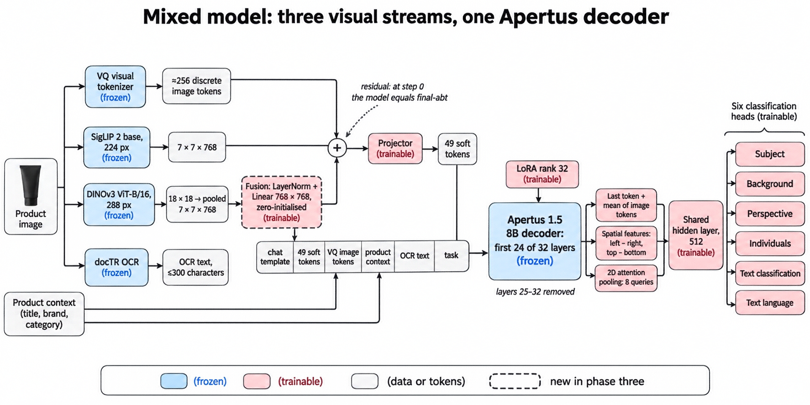

# Technical report — Apertus mixed-encoder product classifier, BYMO

A deeper write-up than the README: what we built, how it works, and what the numbers say. A longer account with all
intermediate experiments is in the [paper](paper/paper.pdf) ([source](paper/paper.tex)).

- **Challenge partner:** Digitec Galaxus
- **Challenge:** Product image classification (six dimensions)
- **Event:** On-site Zurich
- **Team:** BYMO — Nathan Monzani, Nikola Manev, Kristian *(full member list to be confirmed)*
- **Demo:** *link to video to be added*

## 1. Summary

Galaxus asks for six labels per product image: subject, background, perspective, individuals, text classification
and text language, scored as the mean of per-dimension macro F1. Zero-shot prompting of Apertus 1.5 reached at most
0.583 on our local coverage set (70B), so we trained the 8B model instead. Our delivered model keeps Apertus' native
VQ image tokens and adds two frozen open-weights encoders, SigLIP 2 and DINOv3. DINOv3 is fused into the SigLIP
stream through a zero-initialised residual, and the fused features enter the decoder as 49 continuous tokens. OCR text
(docTR) goes into the prompt, and six classification heads with spatially aware readouts sit on a 24-layer Apertus
decoder trained with LoRA. It scores **0.84215 macro F1 on the public dev leaderboard**, against 0.806 for Gemini 3.8
Flash and 0.917 for the organisers' fine-tuned Qwen 3.5 9B. A two-decoder ensemble scored 0.84700 but halves the
speed, so we deliver the single decoder. The 0.84215 score comes from our original export path. The delivery inference path (merged LoRA, TF32, selective perspective
test-time augmentation) classifies **11.68 images/s on one H200**, about 2.4 GPU-hours per 100,000 images. It agrees
with the scored predictions on at least 99.4% of cells (97.5% for perspective, which the augmentation changes on
purpose).

## 2. Architecture



*Figure: the delivered model. The three earlier strategies are in
[paper/figures/three-strategies-revised.png](paper/figures/three-strategies-revised.png).*

**Components and data flow** (one forward pass per image, no text generation):

1. **Inputs:** the product image and its context (title, brand, category from the CSV).
2. **Native VQ tokens:** the frozen Apertus VQ tokenizer turns the image (about 256 px, aspect kept) into about 256
   discrete tokens.
3. **SigLIP 2** (`google/siglip2-base-patch16-224`, frozen): patch features pooled to a 7 × 7 × 768 grid.
4. **DINOv3** (`facebook/dinov3-vitb16-pretrain-lvd1689m`, frozen, 288 px): patch grid pooled to 7 × 7 × 768,
   passed through a trainable LayerNorm + Linear 768 × 768 whose weight starts at zero, and **added** to the SigLIP
   grid. At step 0 the model equals the SigLIP-only model exactly; this is asserted on GPU before training.
5. **Projector** (trainable, 768 → 4096 → 4096): turns the fused grid into **49 soft tokens**.
6. **OCR** (docTR `fast_base` detector + `Felix92/doctr-torch-parseq-multilingual-v1` recogniser, frozen) reads the
   original image; up to 300 characters, largest text first, go into an `<ocr>` block of the prompt.
7. **Decoder:** sequence = chat template | 49 soft tokens | VQ tokens | context | OCR | task. Apertus 1.5 8B is
   truncated to its **first 24 of 32 layers** (layers 25–32 removed; layer 24 was the best frozen-feature layer in
   our probes), with rank-32 LoRA on q/k/v/o/up/down.
8. **Readout and heads** (trainable): last token ‖ mean of VQ states ‖ mean of soft-token states, plus spatial
   features (left − right and top − bottom half-means, which change sign under mirroring) and 2D attention pooling
   (8 queries, Fourier row/column positions). These feed a 512-unit hidden layer and **six heads** (13/3/10/2/6/7
   classes).
9. **Selective perspective TTA:** if the two most likely perspective classes are a left/right pair with margin
   < 0.15, the image is mirrored, re-scored, left/right swapped and averaged into perspective only (about 4% of dev
   images).

About 98.5 M parameters are trained; everything else is frozen.

**Where each part runs.** All inference runs in one process on one GPU. Image decoding runs in a CPU thread pool;
OCR runs on the GPU in its own thread, one batch ahead; the encoders, VQ tokenizer and decoder run on the GPU. For the competition we ran this process on rented
cloud GPUs (Modal; HF Jobs for earlier models), and training also ran there. Nothing at runtime calls an external API
or a closed model.

### Target architecture (mandatory)

**Target: a) on-premise.** At runtime the system needs only:

- one GPU: measured peak 29.2 GiB at batch 32 on an H200 and 23 GiB at batch 16 on an H100 (smaller cards not
  tested), Python 3.12 and the pinned libraries;
- local copies of the weights listed in section 7, under the organisation's own administration.

Every runtime model is Apertus or open weights, and the classification itself calls no hosted LLM or API. **How it
meets the constraint, and what is still missing:**

- **Weight downloads.** At load time the current code resolves weights through the Hugging Face Hub
  (`snapshot_download`, `from_pretrained`). docTR downloads its `fast_base` detector from its own release host. On
  a server with a pre-filled cache this uses local files. For an **air-gapped** install (b), the caches must be
  pre-filled and `HF_HUB_OFFLINE=1` set; we have not tested this.
- **Hosting.** Our competition runs used cloud GPUs (Modal), which is not a Swiss sovereign cloud. We have not done a
  full install on our own hardware.
- **Pinning.** The SigLIP 2 and docTR detector weights are not pinned to a revision in code (see section 5).

**External dependencies.**

| | Build / provisioning time (network needed) | Runtime |
|---|---|---|
| Model weights | Hugging Face Hub: Apertus 1.5 8B (gated) `1519de0a…`, SigLIP 2 base, DINOv3 ViT-B/16 (gated) `5931719e…`, docTR recogniser `8bde31c8…`; docTR release host: `fast_base` detector; this repo (Git LFS): our LoRA, projector, fusion and heads | local cache (Hub lookup unless `HF_HUB_OFFLINE=1`) |
| Code | swiss-ai Transformers fork `3797303d…`, XIELU kernel `nickjbrowning/XIELU@2a55f6b9…`, PyPI: torch 2.8.0, torchvision 0.23.0, peft 0.22.0, accelerate 1.16.0, python-doctr 1.1.0 | installed environment |
| Data | Kaggle competition files (encrypted final archive + SHA-256 check, `7z`) | local images and CSV |
| Development only (not part of the system) | Keera API (zero-shot baselines, live demo), Hugging Face Jobs and Modal (training and benchmarks), Kaggle API, ElevenLabs (video voiceover), AI coding assistants | — |

## 3. Use of Apertus

- **Model:** `swiss-ai/Apertus-v1.5-8B`, revision `1519de0ae7f3d114879291810a58259966f64c99` (delivered system).
  `Apertus-v1.5-70B` and 8B via the Keera API for zero-shot baselines only.
- **How it is used:** fine-tuning (LoRA rank 32, α 32, dropout 0.05 on the first 24 layers) with classification heads,
  plus evaluation. The decoder is the only language model in the system. The native VQ image tokenizer is used frozen
  as one of the three visual inputs.
- **Where it runs:** local weights in a single PyTorch process (bf16 decoder; VQ tokenizer in fp32 with optional
  TF32). For the competition this process ran on cloud GPUs (Modal H200/H100).
- **Setup details:** prompt = Apertus chat template + soft-token slots + VQ block + `<context>` + `<ocr>` + a fixed
  task sentence (`src/training/phase-3/src/training/apertus-8B-vadapter-lora-heads/encoders.py`). LoRA is merged into the weights for
  inference. No quantisation. Serving stack: plain PyTorch + Transformers fork; no inference server.
- **Zero-shot findings** (8B and 70B, 512 px, temperature 0): the best prompt asks for a description and then one
  letter per dimension (seven requests per image). 70B scored 0.583 on coverage, 8B 0.528; a long rule-based JSON
  prompt scored 0.304 and 0.229. See [plain-benchmark results](src/plain-benchmark/RESULTS.md).

## 4. Data

- **Source:** the Galaxus Kaggle competition `hackapertus-galaxus`: 11,876 labelled training images, 5,261 unlabelled
  public-dev images and 5,292 final images, from 14,118 products. Train, dev and final have disjoint product IDs. The
  data is downloaded with [src/scripts/db_download.py](src/scripts/db_download.py) into `data/`, which is git-ignored.
  Rules and metric: [challenge description](challenge_description.md).
- **Licence and redistribution:** the data is provided by Digitec Galaxus for the challenge under the competition
  terms. We do not redistribute images, labels, image IDs or predictions; generated job bundles that embed IDs stay
  private. Some images show people; the data came from the organiser, and we collected no personal data ourselves.
- **Labels:** about one fifth of label cells are model prelabels. Text language is most affected (59% human). We
  train and evaluate only on relevant human-labelled cells.
- **Our splits** (product-disjoint, by hashing products into 10 buckets): *prompt-test* (1,193 images, natural class
  distribution), *coverage* (2,532 = prompt-test + one more bucket + 169 rare-class images), and a balanced 450-image
  prototype set for early experiments. The delivered model trained on the 10,683 images outside prompt-test.
- **Why this protocol:** the rarest classes are rare in the whole dataset: 21 human-labelled Dutch cells, 47 Italian
  and 60 certification seals. Any holdout holds only a handful; a 20% one would add no Dutch example and take Italian
  and seal examples from training. K-fold cross-validation would multiply the cost of every 8B experiment. We
  therefore used two signals:
  - **prompt-test**, fixed, product-disjoint and with the natural class mix, for per-class diagnostics and the choice
    of epoch within a run. Its resolution was measured by product bootstrap: the delivered model scores 0.843
    [0.816, 0.864], and differences between related checkpoints are resolvable from about 0.016;
  - **public dev**, as the arbiter between models.

  Train and dev have nearly the same category mix (total-variation distance 0.026).
- **Dataset analyses** ([src/db_exploration](src/db_exploration/RESULTS.md)):
  - The product context alone (title, type, brand, category) reaches 0.438 macro F1 with a TF-IDF logistic
    regression, mostly on text language (0.518), far below the delivered model's 0.843.
  - Images of one product share background, individuals and text labels in 71–86% of products, but perspective in
    only 20%. We therefore classify each image on its own.
- **Synthetic data:** 1,040 images generated from training products by
  [make_synthetic_text.py](src/scripts/make_synthetic_text.py): promotional banners in Dutch, Italian, French and
  other languages, generic seal-like badges (not real certification marks) and wordless icons. Only the two text
  dimensions are supervised on them, at loss weight 0.25.
- **Pseudo-labels:** soft teacher targets on unlabelled dev images were built for a distillation pilot (allowed by the
  rules) but not used in the delivered model. **No final images were used for training.**

## 5. Limitations

- **Resolution of local scores.** Per-class scores of the rarest classes rest on four to six prompt-test examples
  (Dutch, Italian, seals), with intervals spanning most of [0, 1]. Prompt-test also chose the delivered model's epoch
  among five, so its 0.843 includes that choice. Public dev (0.842) confirms it, but it is a single number without
  per-class detail.
- **Gains that were not confirmed.** Synthetic text gave +0.026 on prompt-test but −0.003 on dev; a trainable SigLIP
  LoRA gave +0.015 and +0.0035. Both gains sat in the rarest classes. Under our two-signal rule they stay
  unconfirmed, and neither is part of the delivered model.
- **Confounded comparisons.** Data, epochs, resolution and auxiliary inputs changed together in most steps. There is
  no matched control for SigLIP 2 vs VQ only, or for DINOv3 vs the same extra training without it. Most runs use one
  seed.
- **Known failure modes:** left/right perspective and text classification (the two weakest dimensions, 0.776 and
  0.769 macro F1 on prompt-test), rare languages and certification seals, and small or stylised text that OCR misses.
  Confident errors are shared across our models: none of six inspected "label error" candidates was a real error.
- **Delivery configuration:** TF32 changes 0.7–0.9% of VQ tokens (macro F1 −0.0008 on prompt-test). The TTA gain
  (+0.0017) was measured without TF32. The combined preset ran on dev (11.68 images/s, ≥ 99.4% agreement with the
  submitted predictions outside perspective) but has no labelled score of its own.
- **Not tested:** an offline or air-gapped install, robustness to missing product context, and GPUs other than the
  H200 and H100 (the A100 80 GB fallback is configured but never ran this model). The demo GPU worker was not run
  against the real models; the demo shows recorded predictions.
- **Provenance gaps:** the SigLIP 2 revision and the docTR detector weights are not pinned. The mixed training ran on
  Modal from a job bundle that was not preserved; the hyperparameters, seeds and fusion code are identical in commit
  `efa299c`, the first committed mixed implementation. No dependency lock file is committed (uv resolves at build
  time). The delivered model descends from checkpoints trained with an early random-crop augmentation, which could
  cut part of the product; it was later replaced.
- **Licences:** DINOv3 weights are gated and distributed under Meta's own DINOv3 licence. We have not formally
  checked that licence against the challenge's open-weights rule.
- **Distillation** was designed and unit-tested but not run; we report no result.

## 6. Reproducibility

- **Exact commit:** *final submission commit to be recorded after the 13:00 run.* It must be `37aea4b` or later:
  `37aea4b` fixes an in-place update in the selective TTA that stopped the `final` preset at its first batch. The
  delivered weights were added in `efa299c`.
- **Hardware:** inference on one NVIDIA H200 141 GB (also measured on an H100 80 GB); training of the mixed model on
  one H200 (Modal), about 2 hours including a 23-minute feature cache and about 18 minutes per joint epoch; peak
  training memory 61.25 GiB.
- **Runtime:** Python 3.12, torch 2.8.0, torchvision 0.23.0, swiss-ai Transformers fork
  `3797303dda74844e3d1f8977ff5518bb91f818b4`, peft 0.22.0, accelerate 1.16.0, python-doctr 1.1.0
  (pins in [build_hf_job.py](src/training/phase-3/src/training/apertus-8B-vadapter-lora-heads/build_hf_job.py), reused by the
  inference job).
- **Seeds:** 3407 globally and for the fusion stage, 3408 for the joint stage; bootstrap seed 3407. The selected
  checkpoint is joint epoch 3 of run `mixed-modal-20261128-033303`.
- **Environment variables:** `HF_TOKEN` (gated Apertus and DINOv3, private repos), `KAGGLE_API_TOKEN` (data),
  `FINAL_PASSPHRASE` (final archive, never written to disk). `LLM_NAME`, `LLM_BASE_URL` and `LLM_API_KEY` are needed only for
  the zero-shot baselines and the live demo (Keera; e.g. `LLM_NAME=apertus-v1-5-8b`,
  `LLM_BASE_URL=https://gateway.keera.ch/api/v1`), not by the delivered model.

**Run the delivered model** (judges: use the local path; the Modal path reads our private Hugging Face repositories):

```sh
# 1. setup (Linux, one CUDA GPU, Python 3.12)
git lfs pull                                    # our weights: weights/apertus-8B-mixed-lora-heads-final/
export HF_TOKEN=…            # access to the gated Apertus 1.5 8B and DINOv3 weights
export KAGGLE_API_TOKEN=…    # competition data
python src/scripts/db_download.py               # from the repository root: data/ with CSVs, images, final_encrypted.bin
cd src/training/phase-3                         # standalone working root of the delivered phase
ln -s ../../../data data                        # its own data/ (or copy the files there)
pip install -r src/training/apertus-8B-vadapter-lora-heads/requirements-gpu.txt python-doctr==1.1.0 kaggle==2.2.5 six
apt-get install -y libgl1 libglib2.0-0 p7zip-full   # OpenCV for docTR, 7z for the final archive

# 2. dev images: same flags as the Modal "final" preset
python src/training/apertus-8B-mixed-lora-heads/fast_infer.py \
  --checkpoint ../../../weights/apertus-8B-mixed-lora-heads-final --data-dir data --csv data/dev.csv \
  --out data/runs/mixed/dev --batch 32 --merge-lora --sort --ocr-thread --tf32 --tta-perspective selective

# 3. final images, after the passphrase is published
7z x -p"$FINAL_PASSPHRASE" -odata/final data/final_encrypted.bin
python src/training/apertus-8B-mixed-lora-heads/fast_infer.py \
  --checkpoint ../../../weights/apertus-8B-mixed-lora-heads-final --data-dir data/final --csv data/final/final.csv \
  --out data/runs/mixed/final --batch 32 --merge-lora --sort --ocr-thread --tf32 --tta-perspective selective

# 4. Kaggle file = dev rows + final rows, validated, never auto-submitted
python src/scripts/final_submission.py --dev <dev.csv> --final <final.csv> --out <submission.csv> \
  --sample data/sample_submission.csv

# what we ran for the competition, from the repository root (Modal, private repositories; final images decrypted
# on the job disk)
python3 src/training/apertus-8B-mixed-lora-heads/build_infer_job.py
FINAL_PASSPHRASE=… modal run src/training/apertus-8B-mixed-lora-heads/modal_infer.py --runs final --local-hf-auth
```

The local command uses the flags of the Modal `final` preset; we ran it through Modal, not in exactly this local form.
The phase-3 copies of `fast_infer.py` and `mixed_model.py` are identical to the files the Modal job bundles; the
Modal commands keep their original path because the phase-3 `modal_infer.py` was later changed (no GPU fallback, no
default repositories), so it is not the file we ran. Measured results of every inference configuration:
[phase-3 results](src/training/phase-3/RESULTS.md#inference-optimizations).
Training commands for every phase, and the evidence still missing for each, are in the
[reproducibility guide](src/training/REPRODUCIBILITY.md):
[phase 1](src/training/phase-1/README.md), [phase 2](src/training/phase-2/README.md),
[phase 3](src/training/phase-3/README.md). Local scores use the competition `metric.py` on prompt-test.
Costs are estimates at $5/h per H200, not invoices.

## 7. Galaxus challenge: results and resources

**Kaggle:** team **BYMO**. Selected submission: *to be confirmed after 13:00*; the planned one is the delivered mixed
model (public dev **0.84215**, submission 59038887: same weights, original export path; the final submission will have
a new ID). Our best public-dev score is a
two-decoder ensemble, **0.84700** (submission 59032216), not selected because it halves the speed. Private score:
from Kaggle.

**Per dimension** (macro F1 by the competition `metric.py` on prompt-test, 1,193 images; also the selection split,
see section 5):

| Model | Overall | Subject | Background | Perspective | Individuals | Text class. | Text lang. | Public dev |
|---|---|---|---|---|---|---|---|---|
| **Mixed (delivered)** | **0.843** | 0.868 | 0.875 | 0.776 | 0.970 | 0.769 | 0.798 | **0.842** |
| SigLIP 2 + VQ (final-abt) | 0.821 | 0.846 | 0.881 | 0.755 | 0.959 | 0.766 | 0.720 | 0.832 |
| LoRA + heads (P11) | 0.791 | 0.861 | 0.894 | 0.620 | 0.990 | 0.805 | 0.577 | 0.796 |

Weighted F1 of the delivered model: 0.924. With the delivery path (TF32 + selective TTA) perspective rises to about
0.789 on prompt-test, measured without TF32.

**What mattered** (public dev unless stated; changes were mostly confounded, see the [paper](paper/paper.pdf)):

| Step | Effect |
|---|---|
| Zero-shot prompt: description first, then one letter per dimension | 8B 0.229 → 0.528 on coverage (70B 0.304 → 0.583) |
| Training with classification heads instead of prompting (LoRA + heads, P11) | 0.796 |
| SigLIP 2 soft tokens + OCR + spatial features + 2D attention pooling + more data (final-abt) | 0.832; prompt-test perspective 0.54 → 0.76 in the step that added the spatial readouts (together with more data and epochs) |
| DINOv3 fused into the SigLIP stream (mixed) | 0.842 (+0.010) |
| Fast path + TF32 + selective perspective TTA | 5.98 → 11.68 images/s; TTA +0.0017 [+0.0001, +0.0039] on prompt-test |

**What did not work:** focal loss vs cross-entropy on frozen features (no gain over 5 seeds); OCR alone
(prompt-test 0.750 → 0.741); synthetic text (prompt-test +0.026, dev −0.003); a larger SigLIP so400m at 512 px
(+0.012 on prompt-test, CI includes 0, 80.7 GB); one more epoch on all data (dev 0.831, a tie); trainable SigLIP LoRA
(dev +0.0035); post-hoc class calibration; random crops (231 of 300 sampled crops removed more than 1% of the image,
enough to turn some full-product views into close-ups); a runtime ensemble (+0.005 for half the speed).
**Not pursued:** distilling the 70B zero-shot model, which is right on perspective only 63% of the time even when
confident.

**Models:**

| Model | Version | Role |
|---|---|---|
| `swiss-ai/Apertus-v1.5-8B` | `1519de0ae7f3d114879291810a58259966f64c99` | **Runtime:** VQ tokenizer + 24-layer decoder with our LoRA and heads |
| `google/siglip2-base-patch16-224` | Hub default (not pinned) | **Runtime:** frozen image encoder |
| `facebook/dinov3-vitb16-pretrain-lvd1689m` | `5931719e67bbdb9737e363e781fb0c67687896bc` | **Runtime:** frozen image encoder |
| docTR `fast_base` + `Felix92/doctr-torch-parseq-multilingual-v1` | python-doctr 1.1.0; recogniser `8bde31c864bcfa47489140b9dddb25ec70f4fd54` | **Runtime:** OCR |
| Our weights `weights/apertus-8B-mixed-lora-heads-final/` | run `mixed-modal-20261128-033303`, joint epoch 3 | **Runtime:** LoRA, projector, fusion, heads |
| `swiss-ai/Apertus-v1.5-70B` and 8B via Keera | gateway revision not recorded | Development: zero-shot baselines |
| `google/siglip2-so400m-patch16-512` | — | Development: P14 experiment |
| `facebook/dinov3-vits16-pretrain-lvd1689m` | — | Development: encoder smoke test only |
| ElevenLabs `eleven_multilingual_v2`; AI coding assistants | — | Development only: demo-video voiceover and coding help; never part of the system |
| Qwen 3.5 9B, Gemini 4 Argon, Gemini 3.8 Flash | — | Organiser reference scores only; never run by us |

**Resources** (delivered configuration, image to CSV, model loading excluded):

| | Value |
|---|---|
| GPU | 1 × NVIDIA H200 (141 GB); peak use 29.2 GiB (smaller cards not tested) |
| Batch size | 32 |
| Throughput | **11.68 images/s** on the 5,261 dev images (model load 76 s); OCR is the critical path |
| Alternative | 14.34 images/s on an H100 80 GB, batch 16, 23 GiB, without TTA |
| 100,000 images / day | ≈ 2.4 H200 GPU-hours ≈ **$12/day** at $5/h (≈ 1.9 H100 GPU-hours without TTA) |
| Final set | 5,292 images in about 8 minutes (extrapolated from the dev rate) |

For comparison, the 70B zero-shot baseline ran at 2.8 images/s on the shared gateway, and our earlier single-encoder
model at 6.91 images/s on an H200 ([zero-shot](src/plain-benchmark/RESULTS.md),
[benchmark](src/training/phase-1/RESULTS.md#h200-benchmark-of-the-three-8b-models-on-public-dev)).

**Commit and weights:** commit *to be recorded* (≥ `37aea4b`). The weights are published in this public repository
via Git LFS, folder [weights/apertus-8B-mixed-lora-heads-final/](weights/apertus-8B-mixed-lora-heads-final/), added
in commit `efa299c` and unchanged since. SHA-256 of the weight files:

| File | SHA-256 |
|---|---|
| `lora/adapter_model.safetensors` | `369d1e075e01612cd7172f4b8d2c8268fda3d6bd44e6e28076a93c6af916e05f` |
| `trainable.pt` | `2809f9eda672ffc33db369caf57218d6029b4c02e984a2de3a7b3a83041c78d9` |
| `mixed_fusion.pt` | `d03d6ee8ee9e6743bc7cd81e84d99f462b10152cd325f6cd9e2339e86aeff4e2` |

The Modal job reads a byte-identical private copy (`nathan-monzani-bymo/galaxus-vlh-private`, path
`mixed-modal-20261128-033303/model/best`; revision `7d5feac45b8ee2f73c0d0a7854cd995bdfabdc6b` holds the same files,
and the job logs the revision it used).

**Suspected label errors sent:** 0. Our search found 57 candidates; none of the six we inspected was a certain error,
so we did not send the list.

## License

All Hack Apertus projects are open-sourced. This report is under Creative Commons Attribution 4.0 (CC-BY-4.0); the
code in this repository is under the [Apache License 2.0](LICENSE). Neither licence covers the competition data or
third-party model weights, which keep their own terms (Apertus, SigLIP 2, DINOv3 and docTR licences apply to their
weights).

## References

- [Challenge description](challenge_description.md) and [FAQ](FAQ.md).
- Paper with the full experiment history: [paper/paper.pdf](paper/paper.pdf).
- Results by phase: [zero-shot](src/plain-benchmark/RESULTS.md), micro-training
  [1](src/micro-training/phase-1/RESULTS.md) · [2](src/micro-training/phase-2/RESULTS.md) ·
  [3](src/micro-training/phase-3/RESULTS.md), training [1](src/training/phase-1/RESULTS.md) ·
  [2](src/training/phase-2/RESULTS.md) · [3](src/training/phase-3/RESULTS.md).
- Results by topic: [decoder fine-tuning, P11, first visual adapter, H200 benchmark](src/training/phase-1/RESULTS.md);
  [P12, OCR stage, final-abt, P13–P15, SigLIP LoRA](src/training/phase-2/RESULTS.md);
  [DINOv3, mixed model, inference ladder, TTA, label errors, distillation, costs](src/training/phase-3/RESULTS.md);
  [phase 4 (pending)](src/training/phase-4/RESULTS.md).
- Dataset analyses: [validation power, context baseline, product consistency](src/db_exploration/RESULTS.md).
- Swiss AI, *Apertus 1.5 Technical Report*, https://arxiv.org/abs/2610.15542.
- M. Tschannen et al., *SigLIP 2*, arXiv:2502.14786; O. Siméoni et al., *DINOv3*, arXiv:2508.10104;
  E. J. Hu et al., *LoRA*, arXiv:2106.09685; docTR, https://github.com/mindee/doctr.
